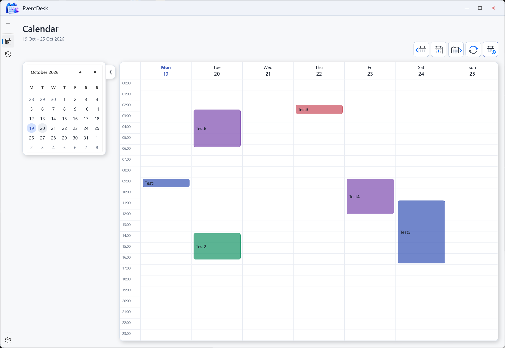
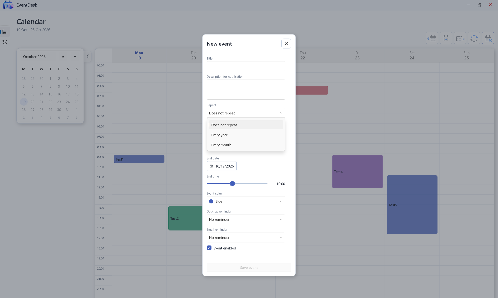
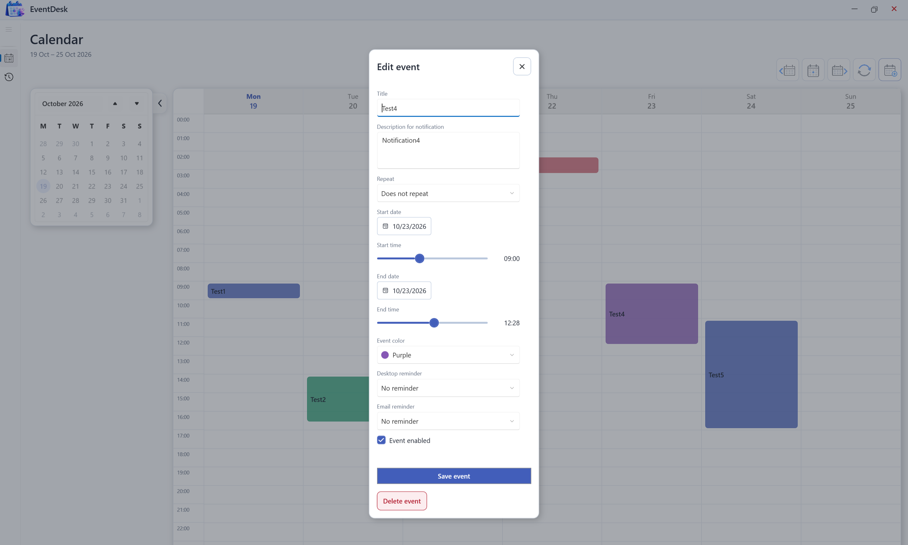
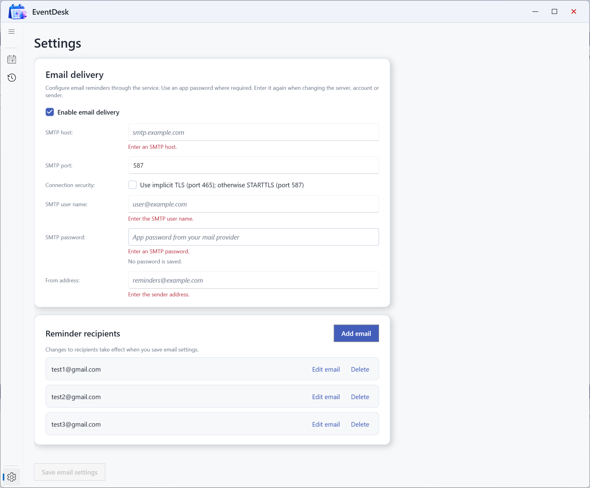

# EventDesk

EventDesk is a Windows desktop calendar for planning events and keeping track of reminders. Its weekly view combines a mini-calendar with a time grid and color-coded events. A background Windows service stores events and processes reminders while the desktop app handles the calendar, settings, and Windows notifications.

## Features

- Plan events in a weekly calendar and jump between dates with the mini-calendar.
- Create, edit, disable, and delete events. Choose a color and add a description to each event.
- Schedule one-time events with desktop and email reminders, or monthly and yearly events with repeated desktop notifications.
- Review reminder delivery status, attempts, and errors in History.
- Configure SMTP delivery and recipient addresses in Settings.
- Keep receiving desktop reminders when the main window is closed and EventDesk is running in the system tray.

For installation and everyday use, see the [user guide](Docs/user-guide.md).

## Screenshots

### Weekly calendar



### Create an event



### Edit an event



### Email settings



## Architecture

Built with C# and .NET 9, EventDesk uses WPF, WPF-UI, and CommunityToolkit.Mvvm for the desktop interface; EF Core and SQLite for persistence; MailKit for email; and WiX Toolset 7 for installation.

The WPF desktop app and Windows service communicate through named pipes. The service owns the SQLite database, processes due reminders, and sends email through SMTP. The desktop app displays Windows notifications in the interactive user session.

```text
EventDesk.App (WPF) <-- named pipes --> EventDesk.Service --> SQLite
       |                                     |
       +-- Windows notifications             +-- Email delivery
```

The event and reminder rules, including daylight-saving behavior, are documented in [the event model](Docs/event-model.md).

## Projects

- `EventDesk.Domain` — business model and rules.
- `EventDesk.Application` — use cases and ports.
- `EventDesk.Infrastructure` — persistence and external integrations.
- `EventDesk.Contracts` — messages shared by the two processes.
- `EventDesk.Ipc` — named-pipe transport.
- `EventDesk.App` — WPF application (`EventDesk.exe`).
- `EventDesk.Service` — Windows Service process.
- `EventDesk.Installer` — WiX MSI package and bundle projects.
- `EventDesk.Resources` — UI strings, styles, images, and controls.
- `EventDesk.Constants` — shared technical identifiers.
- `EventDesk.Logger` — application logging abstraction and Serilog implementation.
- `Tests/*` — xUnit test projects for the core layers.

The desktop application references Contracts, IPC, Resources, and Logger. The service is the composition root for Application, Infrastructure, Contracts, IPC, Constants, and Logger. Domain and Application remain independent of WPF and EF Core.

The desktop shell opens Calendar, History, and Settings through WPF-UI navigation. One-time events can request a desktop reminder, an email reminder, or both. Recurring events use desktop notifications.

## Notifications and email

Closing the main window keeps EventDesk running in the tray. The service sends due desktop reminders to the app through a named pipe; the app shows a Windows tray notification. If the app is not running, the service retries delivery. Use the tray menu to reopen or exit the app.

To send email reminders, open Settings and enter the SMTP host, account, sender, and recipient email addresses. Use STARTTLS on port 587 or implicit TLS on port 465. Enable email delivery and save. Recipient additions, edits, and deletions take effect when the email settings are saved. The password is sent only to the local service when saved, and Settings never reads it back. The service encrypts the entire mail configuration with Windows DPAPI under its own account in `%ProgramData%\EventDesk\Data\MailSettings.dat`. Keep the service account the same after configuration; a different account cannot decrypt the file. Changing the server, account, or sender requires the password again. Messages are sent with recipients in Bcc.

History marks email as delivered when the SMTP server accepts the message. Final arrival in the recipient's inbox is outside the app's control. SMTP has no general delivery idempotency guarantee, so a service crash after SMTP acceptance but before History is updated can result in a repeated email. Recurring event notifications currently use the desktop channel.

## Build

Requires the .NET 9 SDK on Windows.

```powershell
dotnet build EventDesk.sln
dotnet test EventDesk.sln
```

For local use, start the service and then the desktop app in separate terminals:

```powershell
dotnet run --project EventDesk.Service
dotnet run --project EventDesk.App
```

Before starting `EventDesk.App` from Visual Studio or `dotnet run`, exit any installed EventDesk instance through its tray menu. EventDesk allows one instance per Windows user: a second launch activates the running window and exits, even when the new executable was built from a different branch.

The service owns the database under `%ProgramData%\EventDesk\Data\EventDesk.db`; the desktop app only communicates through the named pipe. The service account needs write access to that directory.

## Installer

The WiX MSI project publishes both executables as self-contained .NET 9 applications and packages them in a per-machine MSI. The bundle project wraps that MSI in an x64 installer. Build it on Windows with the .NET 9 SDK:

```powershell
dotnet build EventDesk.Installer/EventDesk.Installer.wixproj -c Release -p:Platform=x64 -p:EventDeskVersion=1.0.0
```

The output is under `EventDesk.Installer/bin/Release/x64/`. Visual Studio solution builds place Debug bundles under `EventDesk.Installer/bin/Debug/x64/`; check that the MSI under `EventDesk.Installer/Package/bin/<Configuration>/x64/en-US/` was updated before running the bundle. Increment `EventDeskVersion` (the first three numeric fields) for every release so the new MSI can replace the previous one. The bundle and MSI use the same version property. WiX Toolset 7 requires the builder to review its [OSMF terms and EULA](https://docs.firegiant.com/wix/osmf/) and accept them locally before building. This repository does not accept the agreement on a builder's behalf.

The installer registers `EventDesk.Service` to start automatically, creates Start menu and desktop shortcuts, and starts the desktop app in the tray at user logon. It leaves `%ProgramData%\EventDesk\Data` in place on upgrade or removal. The service creates and migrates the SQLite database at startup. See [release verification](Docs/release-verification.md) for clean install, upgrade, and removal checks.
