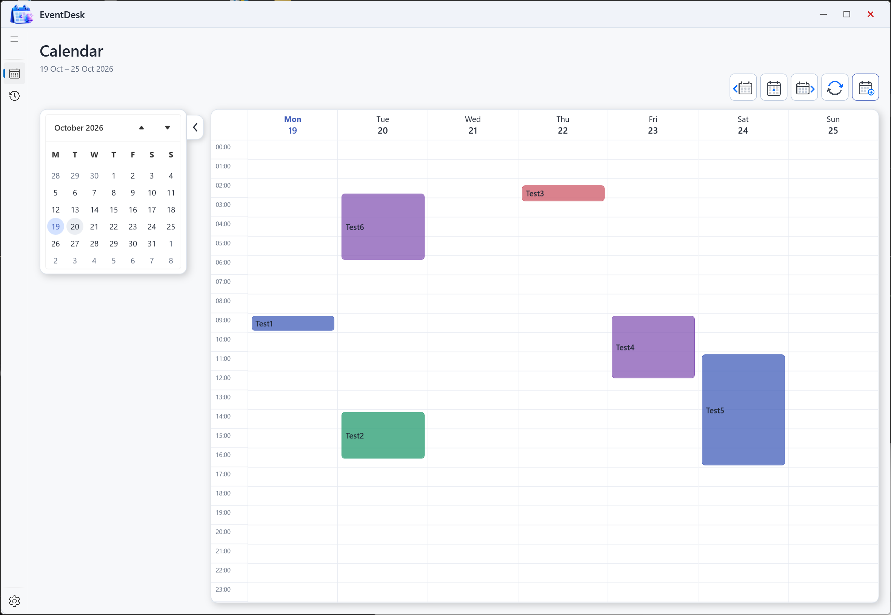
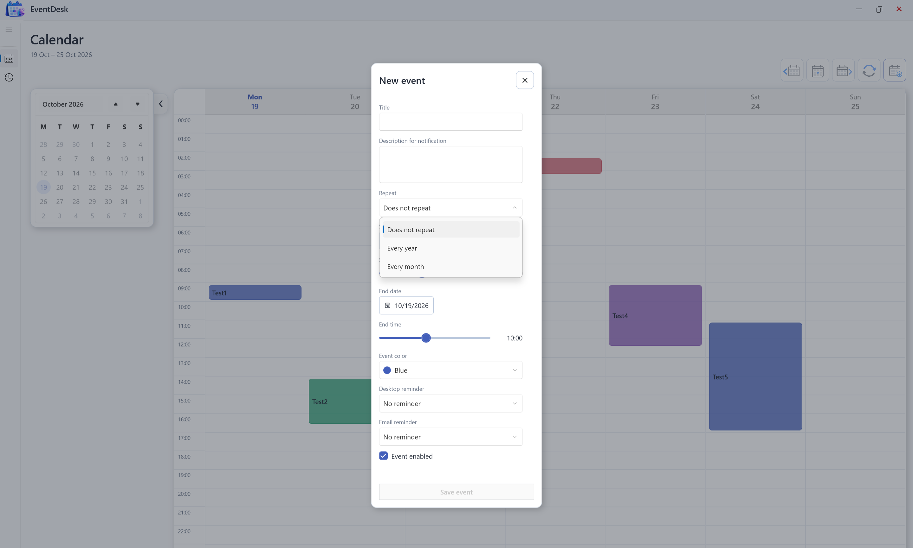
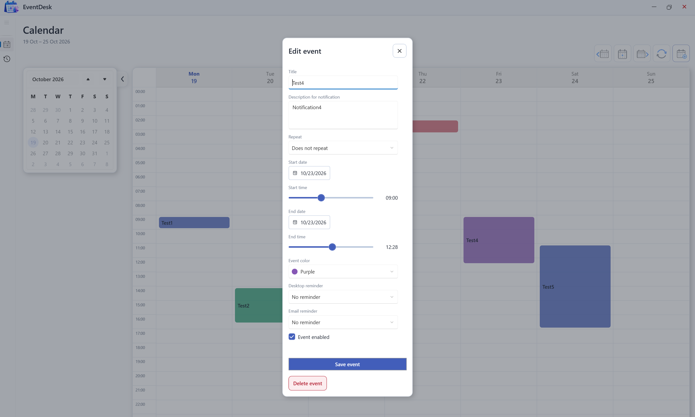
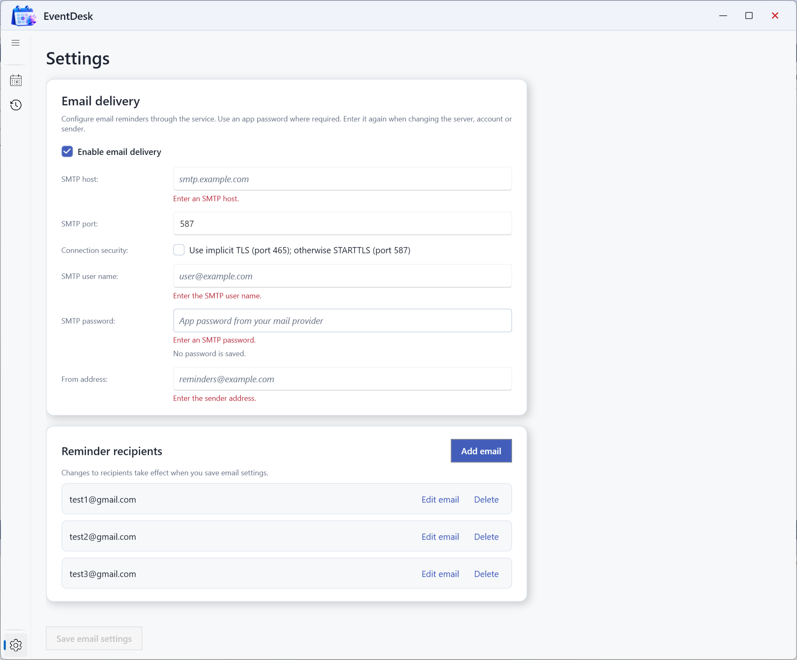

# EventDesk

EventDesk is a Windows desktop calendar and reminder application built with C# and .NET 9. It combines a weekly calendar, a mini-calendar, and color-coded events with desktop and email reminders. A Windows service stores events and processes reminders in the background.

## Features

- Create, edit, disable, and delete one-time, monthly, and yearly events.
- Choose event colors and add descriptions for notifications.
- Set desktop and email reminders for one-time events, or repeated desktop notifications for recurring events.
- Review delivery status and attempts in History.
- Configure SMTP delivery and recipients in Settings.
- Keep the app running in the system tray after closing its window.

## Screenshots

### Weekly calendar

### Create an event

### Edit an event

### Email settings

## How it works

The WPF desktop app communicates with a Windows service through named pipes. The service owns the SQLite database and sends email through SMTP; the app displays Windows notifications in the interactive user session. WiX Toolset 7 packages both processes in a Windows installer.

See the [project README](EventDesk/README.md) for the architecture, build instructions, and installer details, or the [user guide](EventDesk/Docs/user-guide.md) for everyday use.
